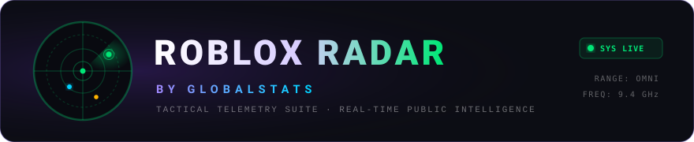

<div align="center">

<p align="center">
  
</p>

<p align="center" style="margin-top: 16px;">
  
  
  
  
</p>

<p align="center">
  A high-performance desktop telemetry dashboard and public intelligence interface for the Roblox platform. Built with Python, pywebview, and direct public web services.
</p>

</div>

---

## Architecture & Core Modules

Roblox Radar operates via zero-credential public endpoints without requiring session tokens, web scraping, or authenticated user accounts.

```
+-------------------------------------------------------------------------------+
|                                  ROBLOX RADAR                                 |
+-------------------------------------------------------------------------------+
|  [Tactical Radar Scope]    [Live Presence Engine]    [Server Discovery Hub]   |
|  - 360 deg Polar Sweep     - Delta State Detection   - Ping & Latency Gauges  |
|  - Target Distance Rings   - Native Toast Alerts     - Direct Protocol Launch |
+-------------------------------------------------------------------------------+
|  [Profile Intelligence]   [Group Explorer]           [Catalog Engine]         |
|  - Dossier & Signals       - Structure & Roles       - Real-time Price Lookup |
|  - Headshot Thumbnails     - Community Experience    - High-Res Visual Assets |
+-------------------------------------------------------------------------------+
```

---

## Functional Capabilities

### Player Presence Radar
* **360-Degree Tactical Scope:** Real-time canvas-based sonar sweep visualizing tracked player presence by status tier (In Game, In Studio, Website/App, Offline).
* **Target Lock-On:** Interactive blips on the radar display that scroll to and highlight player dossiers.
* **State Transition Notifications:** Native desktop toast alerts featuring cached user avatar headshots and status change descriptions.
* **Audio Telemetry System:** Procedural Web Audio synthesizer generating sonar sweep tones, lock-on pings, and tactile click feedback.

### Server Discovery Engine
* **Performance Telemetry:** Displays player capacity density, server frames per second (FPS), and real-time network latency metrics with dynamic color thresholds.
* **One-Click Launch:** Protocol handler invocation (`roblox://experiences/start?...`) for immediate client connection to active server instances.
* **Filter Controls:** Capacity thresholds and full-server exclusion filters.

### Profile Intelligence & Comparison
* **Public Profile Dossier:** Account creation chronology, badge records, official verification flags, and ban states.
* **Side-by-Side Comparison:** Comparative audit between multiple accounts analyzing friend, follower, and following counts.
* **High-Resolution Asset Resolution:** Native integration with official Roblox thumbnail delivery infrastructure.

### Group & Catalog Discovery
* **Group Structure Explorer:** Supports both v1 and v2 group hierarchies, returning ownership, verified insignia, member counts, community experiences, and rank divisions.
* **Catalog Matrix:** Queries public catalog listings, showing accurate Robux prices, free item tags, creator attribution, and asset imagery.

---

## Operating System Setup & Execution

### Prerequisites

| Component | Minimum Version | Notes |
| :--- | :--- | :--- |
| **Python** | 3.9 or higher | Ensure `pip` is installed and added to your system path. |
| **Web Runtime** | WebView2 / WebKit | Windows 10/11 includes WebView2 by default. |

---

### Installation

Clone the repository or download the project archive into your workspace:

```bash
git clone https://github.com/your-username/roblox-radar.git
cd "roblox-radar"
```

Install the required system packages:

```bash
python -m pip install --upgrade pip
python -m pip install pywebview requests
```

> **Note for Windows Users:** To enable native Windows toast notifications with custom user avatars, install `winotify`:
> ```bash
> pip install winotify
> ```

---

### Platform-Specific Instructions

#### Windows

You can launch using the included batch runner or via terminal:

```cmd
setup_roblox_radar.bat
```

Or manually:

```cmd
python roblox_radar.py
```

#### macOS

Install `pywebview` along with PyObjC dependencies:

```bash
pip install pywebview requests pyobjc-framework-WebKit
python3 roblox_radar.py
```

#### Linux (Ubuntu / Debian)

Install the required GTK/WebKit development libraries before launching:

```bash
sudo apt-get update
sudo apt-get install -y python3-gi python3-gi-cairo gir1.2-gtk-3.0 gir1.2-webkit2-4.1
pip install pywebview requests
python3 roblox_radar.py
```

---

## Data Storage & Local Persistence

Roblox Radar stores configuration and history locally on the host machine. No external telemetry servers are contacted.

| Path | Format | Purpose |
| :--- | :--- | :--- |
| `tracked_players.json` | JSON | Registry of added user IDs, display names, and pause statuses. |
| `radar_cache.json` | JSON | Local response cache and interval preferences. |
| `radar_history.sqlite3` | SQLite | Time-series data points for watched games and presence changes. |
| `~/.cache/roblox_radar/toast_icons/` | PNG | Cached player avatars for operating system toast notifications. |

---

## Technical Specifications & Privacy

* **Direct Web API Architecture:** Interfaces directly with Roblox public web endpoints without third-party proxies.
* **Rate-Limit Compliance:** Built-in cooldown throttles prevent request flooding and respect service rate limits.
* **Zero Credential Requirement:** Operates without Roblox `.ROBLOSECURITY` cookies, passwords, or authentication tokens.
* **No Telemetry Collection:** All operational metrics, tracked targets, and cache files remain entirely local.

---

## License

Distributed under the terms of the MIT License. See `LICENSE` for further details.
